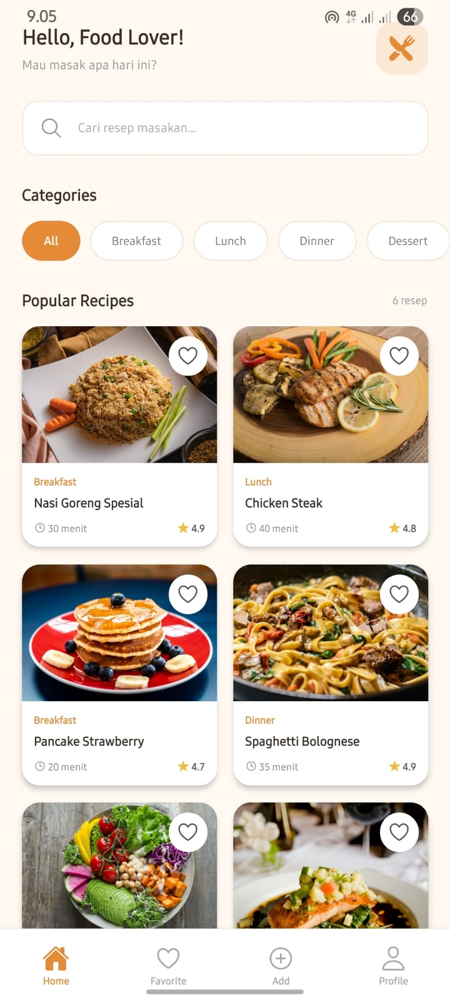
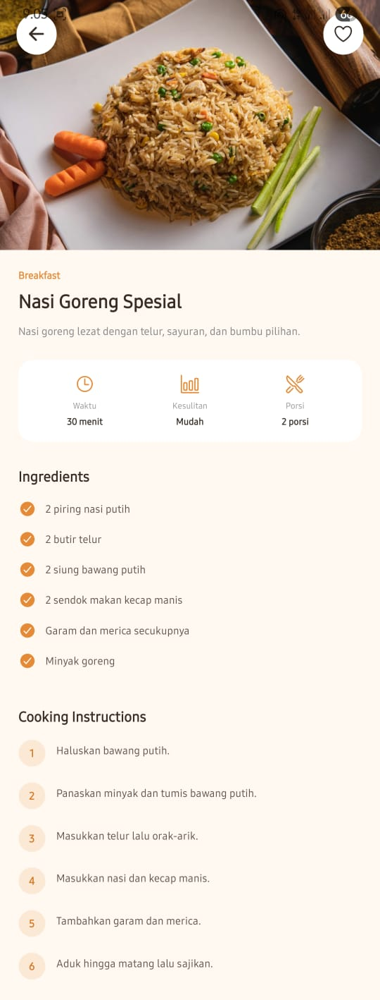
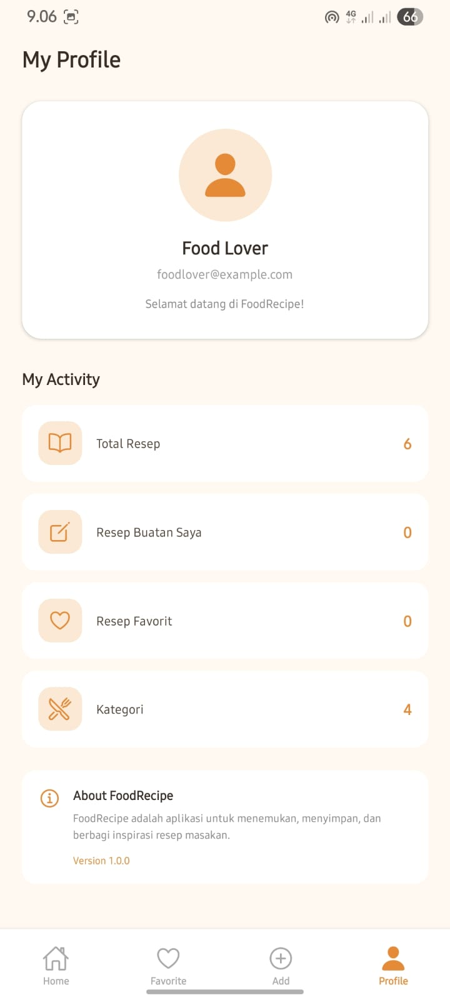

# 🍲 FoodRecipe

Aplikasi mobile resep makanan yang dibangun dengan **React Native** dan **Expo**. Pengguna dapat menjelajahi resep, melihat detailnya, dan menyimpan data secara lokal di perangkat.

## ✨ Fitur

- Navigasi antarhalaman dengan **bottom tab** dan **stack navigation**
- Daftar resep makanan dan halaman detail resep (bahan dan langkah pembuatan)
- Penyimpanan data lokal di perangkat menggunakan AsyncStorage
- [Tambahkan fitur lain, mis. resep favorit, pencarian, kategori]

## 🛠️ Teknologi

| Teknologi | Kegunaan |
|---|---|
| [React Native](https://reactnative.dev/) 0.88 | Framework aplikasi mobile |
| [Expo](https://expo.dev/) ~58 | Toolchain dan runtime pengembangan |
| [React Navigation](https://reactnavigation.org/) (native-stack, bottom-tabs) | Navigasi antarhalaman |
| [AsyncStorage](https://react-native-async-storage.github.io/async-storage/) | Penyimpanan data lokal |
| [@expo/vector-icons](https://docs.expo.dev/guides/icons/) | Ikon antarmuka |
| react-native-screens, react-native-safe-area-context | Pendukung navigasi dan safe area |

## 📸 Tampilan Aplikasi

| Beranda | Daftar Resep | Detail Resep |
|---|---|---|
|  |  |  |


## 🚀 Cara Menjalankan

### Prasyarat

- [Node.js](https://nodejs.org/) (versi LTS)
- npm
- Aplikasi **Expo Go** di HP, atau emulator Android / simulator iOS

### Instalasi

```bash
git clone https://github.com/muhammadsaw250-gif/FoodRecipe.git
cd FoodRecipe
npm install
```

### Menjalankan Aplikasi

```bash
npm start
```

Lalu:

- Scan QR code dengan **Expo Go** untuk membuka di HP, atau
- Tekan `a` untuk emulator Android, `i` untuk simulator iOS, `w` untuk web

Atau langsung dengan script:

```bash
npm run android
npm run ios
npm run web
```

## 📁 Struktur Folder

```
FoodRecipe/
├── assets/          # gambar dan ikon
├── [components/]    # komponen UI
├── [screens/]       # halaman aplikasi
├── [navigation/]    # konfigurasi navigasi
├── App.js
└── package.json
```

> Sesuaikan dengan struktur folder yang sebenarnya.

## 👤 Pembuat

- **Muhamad Abdullah Harun Musa F** – 2430511074 – Kelas B

## 📄 Lisensi

Proyek ini dibuat untuk keperluan tugas kuliah.
